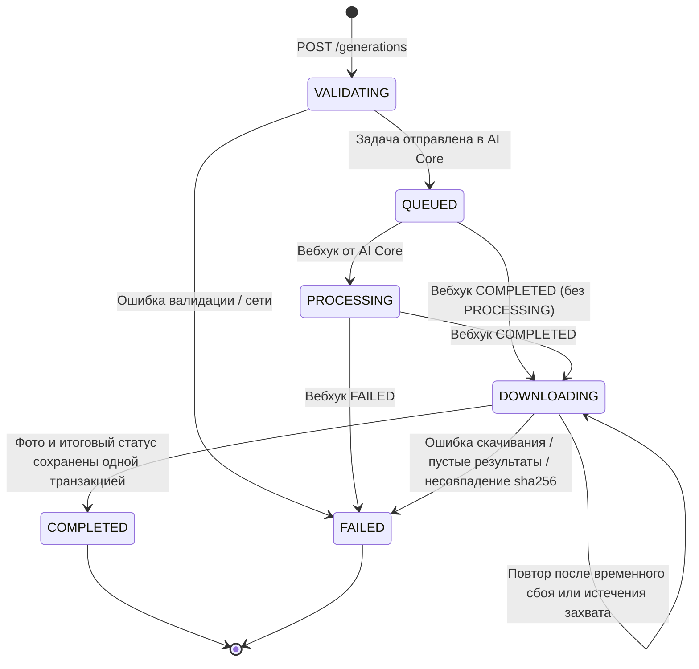

# Архитектура пайплайна генерации и хранилища MinIO

Практическое объяснение ошибок, повторов, адресов и сквозного подключения:
[MinIO и интеграция сервисов](minio_and_integration.md).

Документ описывает стейт-машину статусов задачи генерации, архитектуру хранения медиафайлов в MinIO (S3) и протокол взаимодействия Backend Core с AI Core.

---

## 1. Стейт-машина статусов (Lifecycle & State Machine)

Каждый процесс генерации образов отслеживается в таблице `albums` через поле `status` (`VARCHAR(20)`).



### 1.1. Описание статусов

| Статус | Значение | Что происходит | Допустимые следующие статусы |
|---|---|---|---|
| `VALIDATING` | Валидация и загрузка исходников | Проверяются размеры (до 10 МБ), magic-bytes, поля анкеты. Исходники заливаются в MinIO. Альбом создается в PostgreSQL. | `QUEUED`, `FAILED` |
| `QUEUED` | В очереди AI Core | Запрос `POST /v1/jobs` успешно отправлен в AI Core. В альбоме сохранен `ai_job_id`. Фронтенду возвращен код `202 Accepted`. | `PROCESSING`, `DOWNLOADING`, `FAILED` |
| `PROCESSING` | Генерация моделями AI | AI Core начал отрисовку образов (пришел промежуточный вебхук `PROCESSING`). | `DOWNLOADING`, `FAILED` |
| `DOWNLOADING` | Захват и скачивание готовых образов | Пришел вебхук `COMPLETED`. Backend атомарно зарезервировал задачу и в фоновом режиме скачивает изображения из AI Core в MinIO. | `COMPLETED`, `FAILED` |
| `COMPLETED` | Генерация и сохранение завершены | Фото сохранены в MinIO. Записи `photos`, фактическое `total_photos` и статус сохранены одной транзакцией PostgreSQL. После commit выполняется попытка отправки `ACK`. Альбом готов к выдаче клиенту. | *Терминальный* |
| `FAILED` | Ошибка генерации / скачивания | В поле `error_message` записана причина сбоя. AI Core уведомил об ошибке либо нарушена целостность данных/таймаут. | *Терминальный* |

---

### 1.2. Атомарность, защита от гонок и повторов (Idempotency)

1. **Атомарный захват работы:**
   * В `albums.processing_token` сохраняется уникальный UUID обработчика, в `lease_expires_at` — срок захвата. Захват возможен только при отсутствии владельца или истечении срока, одним условным `UPDATE`.
   * По умолчанию захват действует 120 секунд, heartbeat продлевает его каждые 40 секунд. Повторный вебхук не запускает второе скачивание, пока захват активен.
   * Сохранить результат или ошибку может только владелец ещё действующего токена. Потерявший захват обработчик прекращает работу. Разные попытки пишут файлы под разными префиксами, чтобы старый обработчик не перезаписал файлы победителя.
   * Вебхуки с непосредственным списком `photos`, включая legacy callback, используют тот же захват и ту же транзакцию завершения.

2. **Защита от событий вне порядка (Out-of-Order Events):**
   * Если сетевой пакет вебхука `PROCESSING` задержался и пришел **после** того, как альбом уже перешел в `DOWNLOADING` или `COMPLETED`, метод `atomic_transition` гарантированно отклоняет его (`out_of_order_ignored`). Статус не может откатиться назад.

3. **Периодическое восстановление:**
   * В `lifespan` запускается `generation_recovery.recovery_loop()`, при остановке приложения он отменяется. По умолчанию каждые 30 секунд выбираются до 100 незавершённых альбомов, не обновлявшихся последние 30 секунд и не имеющих активного захвата. Одновременно обрабатываются до 4 альбомов. Время между проходами может увеличиться на длительность обработки.
   * `VALIDATING` без `ai_job_id`: повторяется отправка уже сохранённой генерации. Параметры отправки, включая исходные подписанные URL и `expires_at`, сохраняются в `dispatch_request` до сетевого вызова; повтор использует прежние параметры и `generation_id`, чтобы не вызвать конфликт идемпотентности AI Core. Если ссылки успели истечь и AI Core отклоняет запрос, задача завершается ошибкой.
   * `QUEUED` / `PROCESSING`: backend запрашивает фактическое состояние AI Core. Потерянный вебхук `COMPLETED` таким образом приводит к скачиванию результатов. `DOWNLOADING` с истёкшим захватом также восстанавливается.
   * Временные ошибки сети, PostgreSQL или MinIO при восстановлении/скачивании оставляют задачу доступной следующему проходу. Невосстановимые ошибки доставки завершают её как `FAILED`. Общий срок ожидания по умолчанию — 24 часа от создания; после него восстановление выставляет `FAILED`.
   * Настройки: `GENERATION_RECOVERY_INTERVAL_SECONDS=30`, `GENERATION_LEASE_SECONDS=120`, `GENERATION_TIMEOUT_SECONDS=86400`. Старые терминальные `FAILED` автоматически не возобновляются.
   * Повторные клиентские `POST /generations` остаются независимыми генерациями, даже при одинаковой анкете. Поведение исходного запроса при ошибке отправки сохранено: `502` и `FAILED`. Восстановление отправки предназначено для записей, оставшихся незавершёнными при прерывании процесса.
   * Для новых полей необходима миграция Alembic `0004`.

---

## 2. Как устроено хранилище MinIO (S3)

MinIO — это **объектное хранилище (Object Storage)**, совместимое с Amazon S3 API.

### 2.1. Объектная модель против файловой системы

В отличие от обычной файловой системы (где есть физические директории и файлы), в MinIO данные организованы как **Key-Value хранилище**:

$$\text{Ключ (Object Key)} \longrightarrow \text{Значение (Бинарные данные + Метаданные)}$$

* **Бакет (Bucket):** Единственный верхнеуровневый контейнер для проекта — `stylist`. Создается автоматически бэкендом при старте приложения (`StorageService._ensure_bucket()`).
* **Ключ объекта (Object Key):** Строка-идентификатор, например: `albums/0b457e8e-d98c-4f7a-9a90-fa8cefaee1bd/look_00.webp`.
* **Виртуальные «папки»:** Символы слэша `/` в имени ключа не создают физических папок на диске. Это просто префиксы в имени ключа. Веб-интерфейс MinIO и S3-клиенты визуально группируют ключи по префиксам со слэшами для удобства навигации.

### 2.2. Именование ключей в проекте

Все объекты в бакете `stylist` разделены на две категории:

```text
stylist/
├── sources/                                        <-- Исходные фотографии пользователей
│   └── {user_id}/
│       └── {generation_id}/
│           ├── face.jpg (или .png, .webp)
│           └── body.jpg
│
└── albums/                                         <-- Сгенерированные готовые образы (луки)
    └── {album_id}/
        └── {processing_token}/
            ├── look_00.webp
            ├── look_01.webp
            ├── ...
            └── look_09.webp
```

1. **`sources/{user_id}/{generation_id}/face.{ext}` и `body.{ext}`:**
   * Загружаются пользователем при создании задачи.
   * Ссылки сохраняются в таблице `albums.source_face_key` и `albums.source_body_key`.
   * AI Core забирает их по временным ссылкам.
2. **`albums/{album_id}/{processing_token}/look_{order_index:02d}.webp`:**
   * Сгенерированные луки, скачанные из AI Core.
   * Сохраняются с типом `image/webp`; backend ожидает готовый WebP от AI Core и не выполняет конвертацию. SHA-256 сверяется, если checksum передан в результате.
   * Ссылки сохраняются в таблице `photos.object_key`.

---

### 2.3. Безопасность и Presigned URLs

Бакет `stylist` **закрыт от публичного чтения** (`private`). Никто не может получить файл, просто зная его URL.

Для доступа к файлам используются **Presigned URLs (подписанные временные ссылки)**:
* Ссылка содержит в query-параметрах криптографическую подпись HMAC с ограниченным сроком действия (TTL, по умолчанию 3600 секунд):
  ```text
  http://localhost:9000/stylist/albums/.../look_00.webp?X-Amz-Algorithm=AWS4-HMAC-SHA256&X-Amz-Expires=3600&X-Amz-Signature=...
  ```
* **Для AI Core:** Backend генерирует presigned URL исходников, чтобы AI-сервис мог скачать их в течение времени генерации.
* **Для фронтенда:** При запросе `GET /api/v1/albums/{id}` бэкенд на лету генерирует свежие presigned URLs для каждой фотографии в массиве `photos[].url`.

---

## 3. Сводная таблица взаимодействия сервисов

| Этап | Инициатор | Запрос / Действие | Ответ / Результат |
|---|---|---|---|
| **Создание** | Фронтенд | `POST /api/v1/generations` | Сохранение исходников в MinIO, запись в PostgreSQL, отправка задачи в AI Core $\rightarrow$ `202 Accepted` |
| **Поллинг** | Фронтенд | `GET /api/v1/generations/{id}/status` | Возвращает `{status: "QUEUED" / "PROCESSING" / "DOWNLOADING"}` |
| **Прогресс** | AI Core | `POST /api/v1/internal/ai-events` (`status: PROCESSING`) | Атомарный перевод альбома в `PROCESSING` |
| **Готовность** | AI Core | `POST /api/v1/internal/ai-events` (`status: COMPLETED`) | Атомарный перевод альбома в `DOWNLOADING`, ответ `200 OK` |
| **Скачивание** | Backend Core (Background) | `GET /v1/jobs/{job_id}` к AI Core | Скачивание 10 луков, сверка SHA-256, запись в MinIO и PostgreSQL (`status: COMPLETED`) |
| **Подтверждение** | Backend Core | `POST /v1/jobs/{job_id}/results/ack` к AI Core | После локального commit выполняется попытка ACK; ошибка логируется и не отменяет сохранённый альбом |
| **Отображение** | Фронтенд | `GET /api/v1/albums/{album_id}` | Получение метаданных альбома и 10 presigned URLs для галереи |


### Восстановление доставки и очистка файлов

Публичные ссылки MinIO подписываются с регионом, полученным через внутренний
endpoint. Публичный endpoint используется только в самой ссылке. Синхронное
обращение SDK при получении альбома выполняется в отдельном потоке.

Каждая попытка скачивания имеет каталог `albums/<album_id>/<processing_token>/`.
После ошибки или потери захвата backend удаляет только файлы попытки, на которые
не ссылаются фотографии или сохранённый callback. Проверка выполняется в PostgreSQL
под блокировкой альбома; действующий lease защищает файлы работающего обработчика.
Отмена загрузки дожидается завершения синхронного PUT перед очисткой. При недоступной
БД или ошибке MinIO очистка откладывается. Периодический сборщик повторно проверяет
каталоги старше часа (и как минимум двух сроков lease), включая остатки после
перезапуска процесса. Файлы успешно сохранённого альбома не удаляются, даже если
ответ на commit был потерян.

Если PROCESSING пришёл раньше сохранения `ai_job_id`, recovery повторяет сохранённый
`dispatch_request` с исходными URL, expires_at и generation_id. Это позволяет получить
тот же AI job через идемпотентный контракт AI Core и сохранить продвинувшийся статус.

Legacy callback сохраняет нормализованный список фотографий в
`albums.pending_callback` до успешного HTTP-ответа. При занятом lease ответ содержит
`status: accepted`; recovery завершает альбом из этого списка без обращения к AI Core.
Повтор с тем же содержимым безопасен, конфликтующий ожидающий callback получает 409.
Список ограничен 10 фотографиями с уникальными индексами 0–9 согласно схеме Photo.
Фотографии, статус COMPLETED и очистка pending_callback записываются одной транзакцией.
Для поля pending_callback добавлена миграция Alembic 0005; контейнер применяет её
обычным `alembic upgrade head` при запуске. Сама сборка образа схему БД не меняет.


### Ограниченная очередь доставки результатов

Webhook и recovery направляют готовые альбомы в общую очередь процесса backend.
В ней по умолчанию не более 32 ожидающих альбомов; обработку выполняют 4 работника.
Один альбом не добавляется повторно, пока уже ожидает или обрабатывается.
Перед ожиданием освобождается lease, а состояние DOWNLOADING остаётся в PostgreSQL.
Работник получает новый lease при извлечении из очереди. При переполнении очереди
или перезапуске приложения recovery повторно обнаруживает незавершённый альбом.
Recovery больше не ждёт скачивания готовых альбомов перед следующим проходом.

Общий семафор допускает одновременно не более 4 изображений на весь процесс.
Слот удерживается от начала HTTP-скачивания до завершения PUT в MinIO, включая
ожидание завершения синхронного PUT при отмене. Ожидающие изображения не читаются
в память. Ответ AI Core ограничен 10 результатами с уникальными индексами 0–9.

Настройки: GENERATION_QUEUE_SIZE=32, GENERATION_DOWNLOAD_WORKERS=4,
GENERATION_IMAGE_CONCURRENCY=4. Они передаются в docker-compose через окружение.
При нескольких процессах/репликах каждый имеет собственные лимиты; lease в
PostgreSQL предотвращает одновременную запись одного альбома разными процессами.
Остановка отменяет работников; незавершённые задачи восстанавливаются из БД.


### Актуальный договор AI Core

Источник формата — `src/ai-core/docs/public/ai-core-api/CONTRACT.md`.
Backend отправляет `requested_image_count: 5`, отдельные `inputs.face` и
`inputs.body` с полями `url` и `expires_at`, объект `person` и одиночные
предпочтения `occasion`, `style`, `shoe`, `mood`. Поля `description`, `user_id`,
массивы `styles`, `shoes`, `impressions` во внешнее тело не попадают.
REST-значение `minimalism` преобразуется в `minimal`; `casual` и `street`
передаются без замены. Значения sport и streetwear отклоняются при валидации REST.
Пользовательские ограничения возраста и роста остаются более узкими, чем диапазон
AI Core: 18–100 лет и 120–230 см.

Внутренний HTTP API AI Core не требует Bearer-токена. Новый POST возвращает 201,
идемпотентный повтор — 200; Idempotency-Key содержит generation_id. Число результатов
сохраняется вместе с параметрами отправки; повтор сохраняет исходные URL и срок
их действия. Параметр service_token конструктора оставлен для совместимости
локальных вызовов, но не передаётся AI Core.

Входные ссылки используют HTTP; origin внутреннего MinIO должен быть разрешён
конфигурацией AI Core. Срок подписанных ссылок должен удовлетворять текущему
min_ttl_seconds из `/v1/capabilities`. Backend не обнаруживает и не меняет эти
параметры развёртывания автоматически.

Актуальная интеграция получает состояние через опрос GET /v1/jobs/{job_id} в
recovery, поскольку AI Core по этому договору не отправляет webhook. Существующие
внутренние callback-эндпоинты backend остаются для совместимости со старой интеграцией.
Обработка разрешена только для COMPLETED с `result_delivery_status: AVAILABLE` и
ровно `requested_image_count` файлами. EXPIRED, ACKNOWLEDGED, отсутствующее состояние,
пустая или неполная доставка не сохраняются и не подтверждаются. ACK отправляется
после локального commit и ожидает HTTP 204; 429 и 5xx при получении результатов
остаются временными ошибками. Миграция PostgreSQL для изменения формата не нужна.
